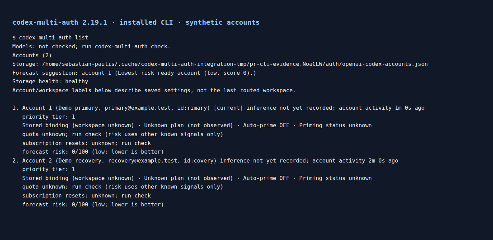

# Integration verification

The v2.19.1 integration preserves the original Pi and WebSocket work and all four recovered pipeline repair commits. The operator cancelled the parked pipeline and recovered its commits before manual verification continued. The cancelled run is not a passing review or test result.

## Manual checks

Code commit `443d8eb824ba83bd05fc16a1478cbc41ab0ece4a` passed:

- `npm test`: 442 suites, 9,100 passing tests and nine existing skips. Single-worker execution and the existing stress settings were unchanged.
- `npm run typecheck`, `npm run typecheck:scripts`, `npm run lint`, `npm run audit:ci`, and `npm run vendor:verify`.
- The normal pre-commit hook, including zero-warning lint and type checking.
- `npm run build`. All 705 emitted files matched an isolated build byte for byte. The globally linked package resolved to this checkout, reported version 2.19.1, and imported all six public exports.
- Installed-code checks for HTTP, native and custom WebSockets, credential recovery, durable restrictions, quota receipts and handshake sanitization. Another 1,390 regression tests passed against emitted JavaScript, including the new revocation-persistence and policy-reindex cases.

Revocation tests first reproduced denial evidence disappearing after an unrelated save. Held-authorization tests first reproduced paused and drained accounts sending after another account was removed. The fixed tests assert persisted denial, zero unauthorized sends, eligible controls, and separately committed credential recovery.

These checks used isolated fixture homes and loopback or injected upstreams. They did not use personal credentials, contact a provider, redeem credits, or test live provider availability. Complete independent review of the integration is still pending. Local tests and installed-code checks are not a substitute for that review.

## Captured CLI output

The image renders stdout captured from the actual globally linked `codex-multi-auth list` command in an isolated fixture home. It uses two synthetic accounts with example.test addresses. It is a terminal-style rendering of captured output, not an interactive-menu or browser-application screenshot. The account summary is not proof of inference eligibility.
